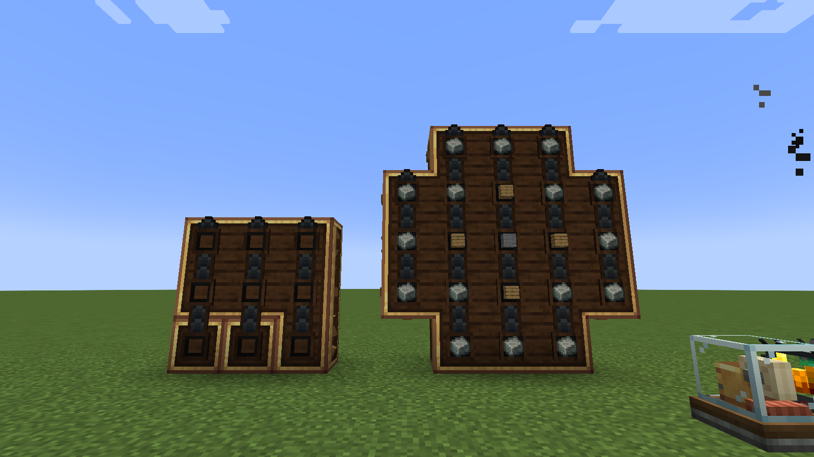
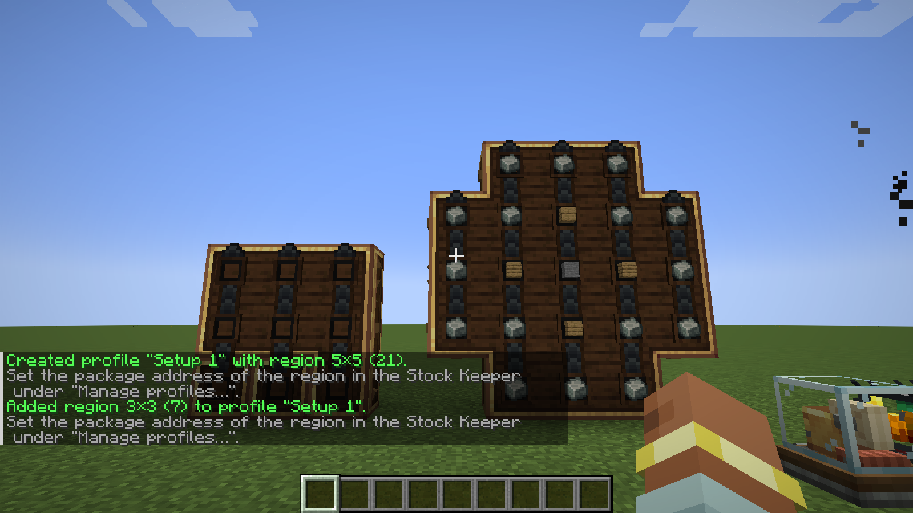
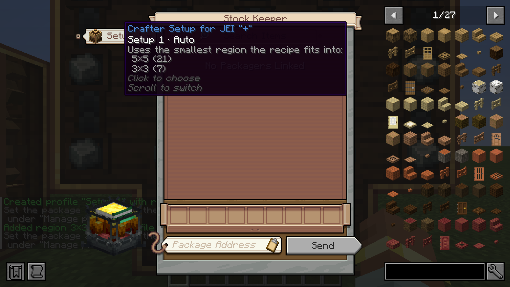
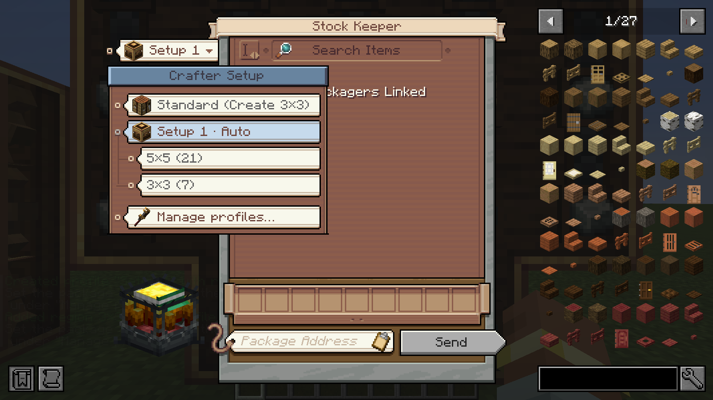
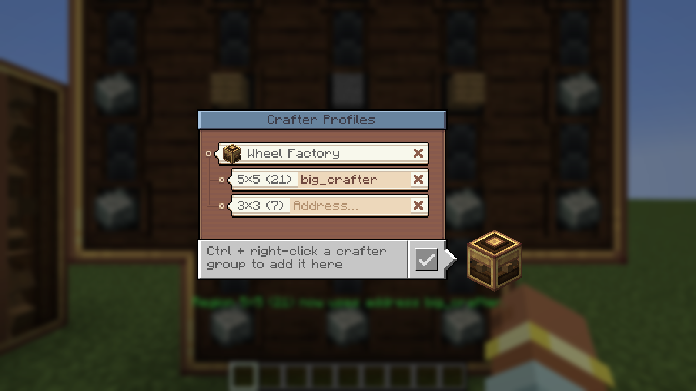
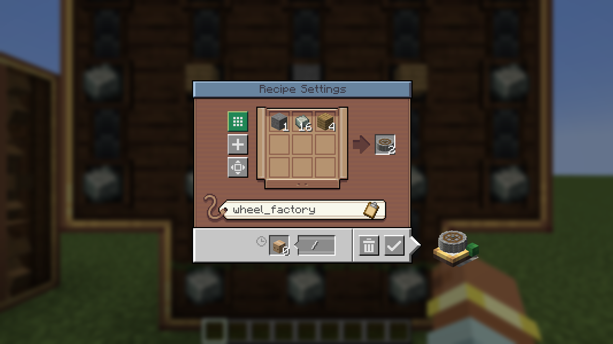
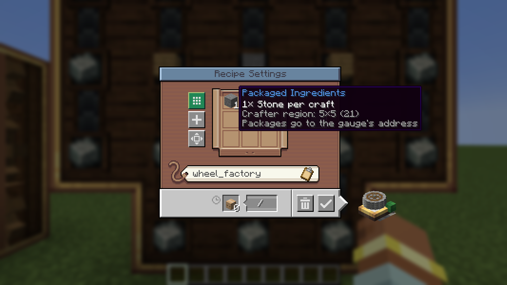

# Big Create Auto Crafter

**Craft recipes bigger than 3×3 with Create's logistics.** Register your big Mechanical Crafter setups once, then order a Crushing Wheel (21 ingredients) straight from the Stock Keeper with JEI's **"+"**, or let a **Factory Gauge** keep it in stock.

*A 21-crafter setup that has just received one Crushing Wheel order (16 Andesite Alloy, 4 Planks, 1 Stone), next to a 3×3 field for small recipes.*

---

## Features

- **Crafter profiles.** Ctrl + right-click a Mechanical Crafter to register its whole connected group as a *region*. One profile can hold several regions, for example a 21-crafter wall for big recipes and a 3×3 field for small ones.
- **Stock Keeper integration.** A paper tag on the Stock Keeper window shows which setup the JEI "+" uses. Click it to choose, or scroll over it to switch:
  - **Standard (Create 3×3):** Create's own behaviour, unchanged.
  - **Profile · Auto:** the smallest region the recipe fits into.
  - **A single region:** exactly that region.
- **JEI "+" for big recipes.** Works for Mechanical Crafting recipes (like the Crushing Wheel) and for regular crafting recipes. Small recipes go into small regions, or into the first fitting spot of a big one.
- **Factory Gauges.** "Use Mechanical Crafting" also works for recipes larger than 3×3. The gauge window shows the amount per craft (16 / 4 / 1 for the Crushing Wheel) and the region it crafts on.
- **Profile menu.** Rename and delete profiles, set package addresses, and remove regions. The menu is built like the Stock Keeper's category editor.
- **Packaging that fits.** For big patterns the Repackager packs by item type, so one craft fits into one package. The crafters only start once the whole grid is filled.
- **Looks like Create.** All menus use the Stock Keeper's paper cards, wood panels, colours, tooltips and sounds.

---

## How to use

### 1. Register your crafters

Build and connect your Mechanical Crafters as usual with Create. Then hold **Ctrl** and right-click one of them. The chat confirms the new region. Ctrl + right-click on another group adds it to the same profile.

- **Ctrl + Shift + right-click** on a registered group removes it.
- The key can be changed under *Controls → Big Create Auto Crafter*.

### 2. Choose the setup in the Stock Keeper

The paper tag on the left of the Stock Keeper window shows the current choice. Hover over it for details, or scroll over it to switch.

Click the tag to see every option as a card. Regions hang from their profile on a thread.

### 3. Set the package address

Open **Manage profiles…** and click the address field of a region. Enter the address of the packager at your crafters, then press Enter. When you order with that region, the address is filled into the Stock Keeper for you.

- **Rename:** click the name.
- **Delete a profile or remove a region:** click the **×** twice.

### 4. Order

Click JEI's **"+"** on any recipe, for example the Crushing Wheel, then press **Send**. The ingredients arrive as packages, and the crafters start once the grid is complete.

### 5. Automate with a Factory Gauge

Set up the gauge as usual: the Crushing Wheel as the target, with input gauges for Andesite Alloy, Planks and Stone. Then click **Use Mechanical Crafting**. The window now shows the amount per craft. Enter the address of the packager at your crafters and confirm.

---

## When do I need a Repackager?

Just like in Create itself, the crafting information is only attached to the packages of **one** packager.

| Situation | without Repackager | with Repackager |
|---|---|---|
| 1 craft, all ingredients from **one** packager | ✅ | ✅ |
| 1 craft, ingredients from **several** packagers | ❌ | ✅ |
| **several** crafts in one order | ❌ | ✅ one package per craft |

A Factory Gauge always requests one craft per order, so there it is enough if all ingredients come from one packager.

---

## Requirements

- **Minecraft** 1.21.1
- **NeoForge** 21.1 (built with 21.1.250)
- **Create** 6.0.10 or a newer 6.0.x version (required)
- **JEI** (optional, client side). Needed for the "+" in the Stock Keeper; Factory Gauges work without it.

Install the mod on **both client and server**.

## Commands

`/bcac list | select | rename | address | delete`. These do the same as the profile menu.

## Server config

| Setting | Default |
|---|---|
| Max. region width / height | 9 / 9 |
| Max. regions per profile | 8 |
| Max. profiles per player | 16 |

## Limitations

- At most **9 different item types per order** (Create's limit).
- Factory Gauges and regions must belong to the **same player**.
- **Unstackable ingredients** (e.g. buckets) can spread one craft over several packages. If packages of several crafts arrive mixed up, the packager may block.

---

## Credits

- This is an addon for [Create](https://www.curseforge.com/minecraft/mc-mods/create) by the Create Team. It is not affiliated with or endorsed by them.
- The menus draw Create's own GUI textures from your installed Create. No Create assets are included in this mod.
- Made for the modpack **Create Exta+**.

## Transparency

This mod was developed with AI assistance (Claude Code by Anthropic). It is tested with automated in-game tests: server-side GameTests and a client test that opens the real Stock Keeper, profile menu and Factory Gauge. All screenshots on this page are unedited captures from that client test.
