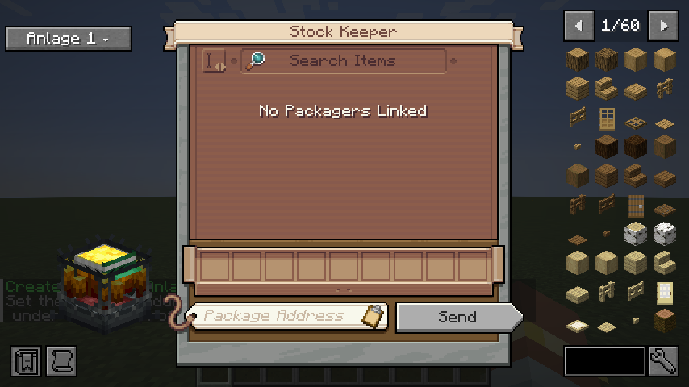

# Prototyp 1: große Crafter-Anlagen im Stock-Keeper-Ablauf

*Screenshot aus dem automatischen Client-Test: links neben dem Stock-Keeper-Fenster sitzt der Auswahl-Button („Anlage 1 · Auto“). Bei dieser kleinen Testauflösung wird der Text gekürzt.*

## Was Prototyp 1 kann

1. **Anlage registrieren:** Strg halten und einen Mechanical Crafter rechtsklicken. Die ganze verbundene Crafter-Gruppe wird als Bereich gespeichert. Ohne aktives Profil entsteht ein neues Profil („Anlage 1“), sonst wird der Bereich zum zuletzt bearbeiteten Profil hinzugefügt. So kommen z. B. die 21er-Anlage und danach ein 3×3-Feld in dasselbe Profil.
   - Strg + Shift + Rechtsklick auf einen registrierten Bereich entfernt ihn. Auf einer neuen Gruppe startet es ein neues Profil.
   - Die Taste ist unter *Steuerung → Big Create Auto Crafter* umbelegbar. Strg ist auch die Sprint-Taste.
2. **Adresse pro Bereich:** `/bcac address <Profil> <Bereich> <Adresse>` setzt die Paketadresse der Crafter-Gruppe. Wird der Bereich benutzt, trägt die Mod sie automatisch in das Adressfeld des Stock Keepers ein.
   - Weitere Befehle: `/bcac list`, `/bcac select <Profil>`, `/bcac rename <Profil> <Name>`, `/bcac delete <Profil>`.
3. **Auswahl im Stock Keeper:** Der Button neben dem Fenster wechselt per Klick vorwärts, per Rechtsklick rückwärts:
   - **Standard (Create 3×3):** Creates Verhalten, unverändert.
   - **Profil · Auto:** Der kleinste Bereich, in den das Rezept passt.
   - **Profil · Bereich:** Genau dieser Bereich.
4. **JEI „+“:** Mit gewähltem Profil funktioniert das „+“ auch für Rezepte mit mehr als 9 Zutaten (z. B. Crushing Wheel, 21 Zutaten). Kleine Rezepte gehen in kleine Bereiche oder in die erste passende Stelle eines großen Bereichs.
5. **Pakete:** Beim Senden erzeugt die Mod ein Muster pro Crafter des Bereichs. Der Repackager packt große Muster nach Itemtyp, also bis zu 64 gleiche Items pro Paket-Slot, damit ein Craft in **ein** Paket passt. Creates Crafter-Entpacker verteilt die Items dann auf die richtigen Crafter.

## Änderungen

- **0.0.3:** Code-Qualität, keine neuen Funktionen.
  - Die Bereichs-Platzierung hängt direkt am Bestelleintrag. Die globale Merkliste und ihre Aufräumstellen sind weg.
  - Der Repackager-Mixin greift nur noch an der einen Stelle ein, an der Create das abgeschnittene Paket hinzufügt. Creates Zählung bleibt dabei unangetastet.
  - Strg + Rechtsklick braucht kein eigenes Tasten-Paket mehr: Der Server unterdrückt genau den einen Klick, für den ein Profil-Klick kam.
  - Der Auswahl-Button baut Text und Tooltip nur bei Änderungen neu und nutzt Creates eigene JEI-Sperrzonen.
  - Die tote Einstellung `autoSelectSmallestRegion` ist entfernt (sie hatte nie eine Wirkung).
  - Client und Server brauchen dieselbe Version (Netzwerkprotokoll 3).
- **0.0.2:** Fehler aus dem ersten Spieltest behoben. Beim Senden wurde die Bestellliste beim Bauen des Musters heruntergezählt. Create fand danach „0 Crafts“ und schickte den Auftrag **ohne** Crafting-Informationen. Die Crafter wurden dann einfach der Reihe nach gefüllt: erst alles Andesit, dann Holz, dann Stein, und die Tür kam kaputt an. Neuer GameTest `orderKeepsCraftingEntry` spielt Creates Zählschleife nach und hätte den Fehler gefunden.
- **0.0.1:** erster Prototyp.

## Wann ein Repackager nötig ist (wie bei Create selbst)

Create legt die Crafting-Informationen nur an die Pakete **eines** Packagers, und sein Crafter-Entpacker nimmt nur Pakete an, deren Items genau in die freien Felder passen. Das gilt für 3×3 genauso wie für große Bereiche:

| Situation | ohne Repackager | mit Repackager |
|---|---|---|
| 1 Craft, alle Zutaten aus **einem** Packager | ✅ | ✅ |
| 1 Craft, Zutaten aus **mehreren** Packagern (z. B. ein Vault pro Item) | ❌ Pakete ohne Info werden der Reihe nach eingefüllt | ✅ |
| **mehrere** Crafts in einem Auftrag | ❌ das Paket enthält Items für mehrere Crafts und wird abgelehnt | ✅ ein Paket pro Craft |

## Wie bisher nötig (Create-Aufbau)

Ein großer Bereich braucht dasselbe wie dein bisheriger 3×3-Ablauf:

- Stock Ticker mit Händler
- Packager an den Lagern
- Repackager vor der Anlage
- Packager direkt an einem Crafter der Gruppe, mit der Adresse des Bereichs

Die Mod ändert keine Blöcke, nur Muster und Paketierung.

## So testest du im Spiel

1. Baue mit `./gradlew build` die Datei `build/libs/bigcreateautocrafter-0.0.3.jar` und lege sie auf Client **und** Server in den `mods`-Ordner (alte JAR entfernen).
2. Baue die 21er-Anlage (5×5 ohne Ecken, wie für das Crushing Wheel), verbinde sie mit dem Schraubenschlüssel und schließe sie wie deine 3×3-Anlage an.
3. Halte Strg und rechtsklicke einen Crafter. Im Chat erscheint „Profil „Anlage 1“ mit Bereich 5×5 (21) angelegt“.
4. Setze die Adresse mit `/bcac address 1 1 <deine Adresse>`.
5. Öffne den Stock Keeper und stelle den Button links auf „Anlage 1 · Auto“.
6. Suche das Crushing Wheel, öffne das Rezept mit JEI und klicke auf „+“ (ohne Shift, also **1** Craft). Sende dann den Auftrag.
7. **Erwartet:** Ein Paket pro Craft kommt an der Anlage an, alle 21 Crafter werden gefüllt und das Crushing Wheel wird gecraftet.
8. Gegenprobe: Mit „Standard“ läuft alles wie vorher, und das „+“ beim Crushing Wheel ist gesperrt.

## Bekannte Grenzen von Prototyp 1

- **Echtes Craften ist ungetestet.** Geprüft sind die Serverlogik (GameTests: Scan, Platzierung, Paketierung, Entpacken in die richtigen Crafter) und der Client mit echtem Create-Screen und JEI (Smoke-Test). Nicht getestet ist der volle Ablauf mit Rotation, Packagern und Paketwegen.
- **Höchstens 9 verschiedene Itemtypen pro Auftrag** (Create-Limit L3, unverändert).
- **Unstapelbare Zutaten** (z. B. Eimer) können einen Craft auf mehrere Pakete verteilen. Die Mod startet den Crafter erst, wenn alles da ist. Kommen Pakete aber in falscher Reihenfolge über mehrere Crafts hinweg an, kann der Packager blockieren (R14).
- **Die Adresse kommt nicht automatisch.** Sie wird pro Bereich per Befehl gesetzt.
- **Kein eigener Server-Check des Musters.** Create vertraut dem Muster vom Client bereits heute, das bleibt so (R6).
- **Der Tooltip des Buttons** ist im automatischen Test nicht sichtbar geprüft. Bitte im Spiel ansehen.
- **JEI-Version des Packs** ist weiter unbestätigt. Die Mod nutzt die Transfer-API, die in allen JEI-19.x-Versionen existiert.
