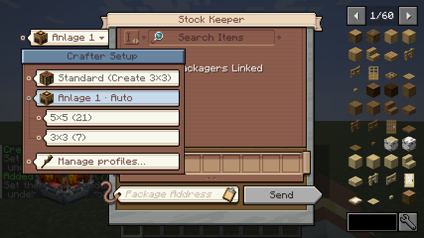

# Bedienung, Test im Spiel und Grenzen (Version 0.1.1)

| Anhänger am Stock Keeper | Auswahl „Crafter-Anlage“ | Fenster „Crafter-Profile“ |
|---|---|---|
|  |  |  |

*Screenshots aus dem automatischen Client-Test (kleine Auflösung 854×480, englische Sprache).*

Die Oberfläche nutzt Creates eigene Stock-Keeper-Texturen (Papierkarten und Holz aus dem Kategorie-Editor), seine Farben, Tooltips und Klänge. Die Texturen werden aus Creates JAR gelesen, nicht kopiert.

## Was die Mod kann

1. **Anlage registrieren:** Strg halten und einen Mechanical Crafter rechtsklicken. Die ganze verbundene Crafter-Gruppe wird als Bereich gespeichert.
   - Ohne aktives Profil entsteht ein neues Profil („Anlage 1“), sonst kommt der Bereich zum zuletzt bearbeiteten Profil. So landen z. B. die 21er-Anlage und danach ein 3×3-Feld im selben Profil.
   - Strg + Shift + Rechtsklick auf einen registrierten Bereich entfernt ihn. Auf einer neuen Gruppe startet es ein neues Profil.
   - Die Taste ist unter *Steuerung → Big Create Auto Crafter* umbelegbar. Strg ist auch die Sprint-Taste.
2. **Auswahl im Stock Keeper:** Links am Fensterrahmen, auf Höhe der Suchleiste, hängt ein Papier-Anhänger mit der aktuellen Wahl (Werkbank = Create 3×3, Mechanical Crafter = Anlage).
   - **Maus darüber:** Tooltip im Create-Stil mit der vollen Wahl, den Bereichen und ihren Adressen.
   - **Scrollen:** wechselt zur nächsten oder vorigen Möglichkeit, wie Creates Auswahlfelder.
   - **Klick:** öffnet das Holz-Panel „Crafter-Anlage“ mit einer Karte pro Möglichkeit. Die gewählte Karte ist hellblau.
     - **Standard (Create 3×3):** Creates Verhalten, unverändert.
     - **Anlage · Auto:** Der kleinste Bereich, in den das Rezept passt.
     - **Bereichskarten** (eingerückt, mit Faden an der Anlage): Genau dieser Bereich.
     - **Profile verwalten…** (Schraubenschlüssel): Öffnet das Fenster „Crafter-Profile“.
   - Klick daneben oder Esc schließt das Panel.
3. **Fenster „Crafter-Profile“:** Aufgebaut wie Creates Kategorie-Editor des Stock Keepers. Es öffnet sich aus dem Panel oder über die Taste *Crafter-Profile öffnen*. Die ist standardmäßig nicht belegt und unter Steuerung einstellbar.
   - **Profilkarte** mit Crafter-Symbol, darunter die **Bereichskarten** am Faden.
   - **Umbenennen:** Auf den Namen klicken, tippen, Enter. Esc bricht ab, ein Klick daneben speichert.
   - **Paketadresse pro Bereich:** Auf das Feld rechts in der Bereichskarte klicken. Wird der Bereich benutzt, trägt die Mod die Adresse automatisch in den Stock Keeper ein.
   - **×:** Zweimal klicken (das × wird rot). Auf einer Profilkarte löscht es das Profil, auf einer Bereichskarte entfernt es den Bereich. Wird der letzte Bereich entfernt, verschwindet das Profil.
   - **✓** (oder Esc) führt zurück zum Stock Keeper.
   - Dieselben Aktionen gibt es auch als Befehl: `/bcac list | select | rename | address | delete`.
4. **JEI „+“:** Mit gewählter Anlage funktioniert das „+“ auch für Rezepte mit mehr als 9 Zutaten (z. B. Crushing Wheel, 21 Zutaten). Kleine Rezepte gehen in kleine Bereiche oder an die erste passende Stelle eines großen Bereichs.
5. **Factory Gauge (automatisches Crafting):** Eine Gauge, deren Adresse die Paketadresse eines deiner Bereiche ist, craftet für diesen Bereich.
   - Im Gauge-Fenster wird dann auch ein Mechanical-Crafting-Rezept wie das Crushing Wheel angeboten, wenn es in einen deiner Bereiche passt.
   - Beim Bestätigen bekommt die Gauge das Muster und die Mengen pro Eingang für genau diesen Bereich, beim Crushing Wheel also 16 Andesit, 4 Bretter und 1 Stein.
   - Gauges mit anderen Adressen bleiben bei Creates 3×3.
6. **Pakete:** Für große Muster packt der Repackager nach Itemtyp, bis zu 64 gleiche Items pro Paket-Slot, damit ein Craft in **ein** Paket passt. Creates Crafter-Entpacker verteilt die Items dann auf die richtigen Crafter.

## Wann ein Repackager nötig ist (wie bei Create selbst)

Create legt die Crafting-Informationen nur an die Pakete **eines** Packagers. Sein Crafter-Entpacker nimmt nur Pakete an, deren Items genau in die freien Felder passen. Das gilt für 3×3 genauso wie für große Bereiche:

| Situation | ohne Repackager | mit Repackager |
|---|---|---|
| 1 Craft, alle Zutaten aus **einem** Packager | ✅ | ✅ |
| 1 Craft, Zutaten aus **mehreren** Packagern (z. B. ein Vault pro Item) | ❌ Pakete ohne Info werden der Reihe nach eingefüllt | ✅ |
| **mehrere** Crafts in einem Auftrag | ❌ das Paket enthält Items für mehrere Crafts und wird abgelehnt | ✅ ein Paket pro Craft |

Eine Factory Gauge fordert immer **einen** Craft pro Auftrag an. Ohne Repackager genügt es dort also, wenn alle Zutaten aus einem Packager kommen.

## So testest du im Spiel

1. Lege `bigcreateautocrafter-0.1.1.jar` auf Client **und** Server in den `mods`-Ordner und entferne die alte JAR. Beide sollten dieselbe Version haben (Netzwerkprotokoll 4, unverändert seit 0.1.0).
2. Halte Strg und rechtsklicke die 21er-Anlage. Im Chat erscheint die Bestätigung.
3. **Stock Keeper:**
   1. Öffne den Stock Keeper, klicke den Anhänger links und wähle **Profile verwalten…**.
   2. Benenne das Profil um, trage die Paketadresse des Bereichs ein und klicke **✓**.
   3. Wähle im Panel die Anlage (oder scrolle über dem Anhänger).
   4. Bestelle das Crushing Wheel per JEI „+“ und sende den Auftrag.
4. **Factory Gauge:**
   1. Baue die Gauge wie bei Create: eine Gauge mit Crushing Wheel als Ziel, verbunden mit Eingangs-Gauges für Andesit, Bretter und Stein.
   2. Trage im Gauge-Fenster die Paketadresse des 21er-Bereichs ein.
   3. Schalte das Rezept ein und bestätige.
   4. **Erwartet:** Die Gauge fordert 16 / 4 / 1 an, und die Anlage craftet das Crushing Wheel.
5. **Verwalten:** Lösche ein Test-Profil im Fenster mit zwei Klicks auf das ×.

## Änderungen

- **0.1.1:** Oberfläche im Stil des Stock Keepers, keine neuen Funktionen.
  - Papier-Anhänger am Fensterrahmen statt des grauen Buttons, Auswahl als Holz-Panel mit Karten, Scrollen zum Wechseln.
  - Fenster „Crafter-Profile“ im Aufbau von Creates Kategorie-Editor: Karten, Faden zu den Bereichen, Bearbeiten per Klick, × zum Löschen.
  - Tooltips, Farben und Klänge wie bei Create.
- **0.1.0:** Neue Bedienung und Factory Gauge.
  - Aufklappliste statt des abgeschnittenen Wechsel-Buttons.
  - Fenster „Crafter-Profile“ zum Umbenennen und Löschen, für Adressen und zum Entfernen von Bereichen. Dazu eine Taste zum Öffnen.
  - Factory Gauges auf Crafter-Bereichen inklusive Mechanical-Crafting-Rezepten.
- **0.0.3:** Code-Qualität, keine neuen Funktionen.
  - Die Platzierung hängt am Bestelleintrag.
  - Der Repackager-Mixin greift nur beim `packages.add` ein.
  - Ein Netzwerkpaket weniger bei Strg + Rechtsklick.
  - Die tote Einstellung `autoSelectSmallestRegion` ist entfernt.
- **0.0.2:** Fehler aus dem ersten Spieltest behoben. Der Muster-Bau zählte die Bestellliste herunter, und Create schickte den Auftrag deshalb ohne Crafting-Informationen. Die Crafter wurden dann der Reihe nach gefüllt.
- **0.0.1:** erster Prototyp.

## Grenzen

- **Echtes Craften mit Factory Gauges ist ungetestet.**
  - Geprüft sind die Server-Logik (20 GameTests, darunter Rezeptsuche und Muster mit dem echten Crushing-Wheel-Rezept) und der Client (Smoke-Test: beide Client-Mixins, Anhänger, Panel, Profilfenster, Umbenennen und Adresse über den Server).
  - Nicht getestet ist der volle Ablauf einer Gauge mit Paketwegen. Den Stock-Keeper-Weg hast du mit 0.0.2 im Spiel bestätigt.
- **Gauge und Bereich müssen demselben Spieler gehören.** Der Client kennt nur die eigenen Profile.
- **Höchstens 9 verschiedene Itemtypen pro Auftrag** (Create-Limit, unverändert).
- **Unstapelbare Zutaten** (z. B. Eimer) können einen Craft auf mehrere Pakete verteilen. Kommen die Pakete über mehrere Crafts hinweg durcheinander an, kann der Packager blockieren (R14).
- **JEI-Version des Packs** ist weiter unbestätigt. Die Mod nutzt die Transfer-API, die in allen JEI-19.x-Versionen existiert.
